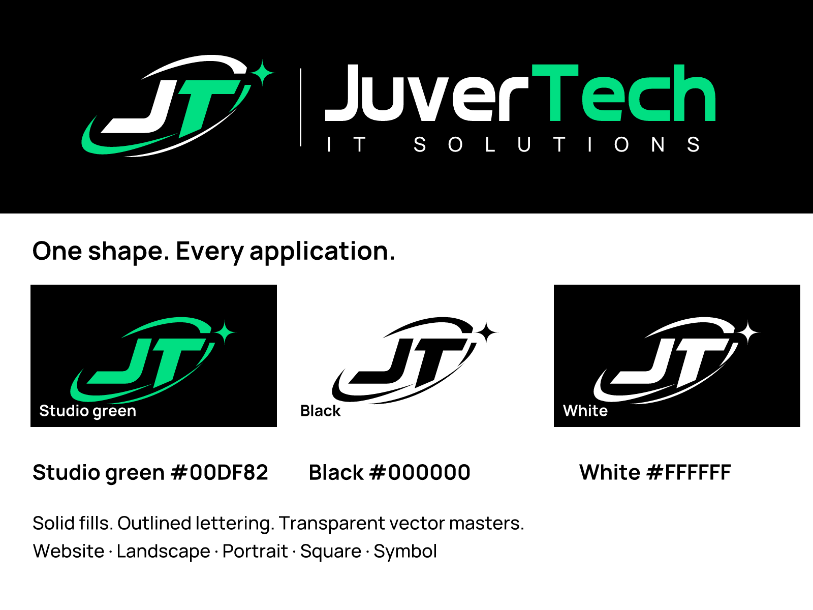
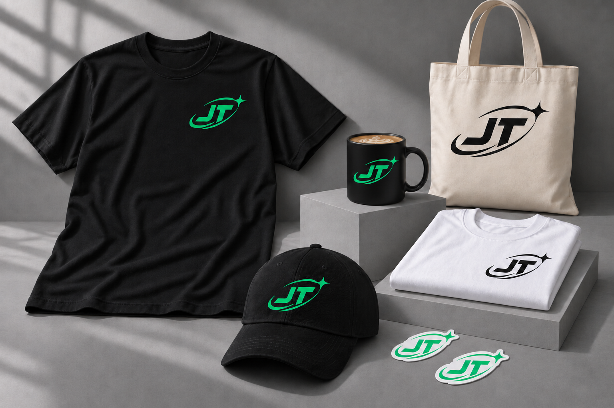

# JUVERTECH IT SOLUTIONS — Brand guide

Approved identity · 16 November 2026 · JT orbit and four-point sparkle



The approved mark combines the leaning JT monogram, tapered orbital sweeps and a single curved four-point sparkle. The orbit represents connected systems; the sparkle suggests a clear result. The existing custom geometric **JuverTech** wordmark completes the signature. This monogram replaces Conch and the earlier orbital pixel cluster. It retains the approved Studio green, taken from the Studio phone color in src/motion/colorways.ts.

## Color

| Color | Value | Use |
| --- | --- | --- |
| Studio green | `#00DF82` | T, return sweep, sparkle and “Tech”; single-ink artwork on dark backgrounds |
| Black | `#000000` | J, outer sweeps and “Juver” on light backgrounds; print artwork |
| White | `#FFFFFF` | J, outer sweeps and “Juver” on dark backgrounds; reversed print artwork |

Use flat, solid fills. No gradients, bevels, glow or texture inside the logo. The primary website signature is green and white on a dark background. Use the all-black lockup on white for maximum small-text contrast. The two-tone light version is available for large display artwork; green is not suitable for small text on white.

RGB values specify screen artwork. Ask the printer to match Studio green to an approved physical ink or thread swatch; printed color may differ from the screen. Supply the SVG master for production and approve a physical proof.

## Logo system

All SVG lettering is outlined, so the logo requires no installed fonts. Do not recreate the wordmark with a substitute font. Keep the monogram, wordmark and descriptor in their supplied proportions. Do not stretch, rotate, outline or rearrange their components. Keep the sparkle; do not restore the pixel cluster.

| Layout | SVG canvas | Recommended use |
| --- | --- | --- |
| Website | 1340 × 240 | Full horizontal lockup with IT SOLUTIONS; use at 280 px wide or larger |
| Compact | 600 × 110 | Small/mobile headers without the descriptor; start at 200 px wide |
| Symbol | 480 × 300 | Monogram for icons and merchandise; inspect fine orbit tips at actual size |
| Landscape | 1920 × 1080 | Wide placements and presentations |
| Square | 1080 × 1080 | Square compositions and profile artwork |
| Portrait | 1080 × 1350 | Tall placements and portrait graphics |

Each format has green, black, white, two-tone-dark and two-tone-light masters: **30 editable SVGs and 30 transparent PNGs**. PNG logos have a 3,000 px long edge. SVGs remain sharp at any output size. The portrait logo PNGs are 2400 × 3000 px; social exports use the exact dimensions below.

Keep empty space around the artwork at least equal to the thickness of the T crossbar. The outer canvas margin is part of the placement: avoid placing text or graphics against the orbit or sparkle. Prefer the supplied square social avatar for a circular profile crop. The favicon uses a dedicated, bold JT on a black rounded tile. Its larger strokes and open gap remain clear at 16 × 16 px. The fine orbital sweeps and sparkle are omitted only in this small browser icon; all full-size logo masters retain them.

## Typography and website

The logo uses a custom outlined geometric wordmark. Supporting logo lettering and social artwork use Manrope. The existing website keeps Barlow Condensed SemiBold for editorial headings and Manrope for navigation and body copy; these are supporting fonts, not replacements for the logo. Both fonts and their SIL Open Font Licenses are included.

The shared website header and footer use `logo-dark.svg`. Mobile headers use `logo-compact-dark.svg`. `favicon.svg` is the editable small-size icon master, with reviewed 16, 32 and 48 px PNG exports and a multi-resolution `favicon.ico` fallback. Re-export those PNGs after changing the SVG; the builder packages them into the ICO. The canonical `website.css` applies the identity's green to calls to action and uses dark neutral surfaces. Both lines of the homepage slogan are white; the description reads “Custom apps and connected systems. Built around your business.” across two lines. Dark green `#007D49` is a functional link/focus shade on light surfaces, not an additional logo ink. Existing cinematic lighting and client-interface colors are separate from logo artwork. Production builds keep the Studio atmosphere, ignore saved preview color choices and exclude the floating theme toolbar and its stylesheet. The toolbar is available only in Vite development mode.

## Social artwork

| Sample | Export dimensions |
| --- | --- |
| Profile / avatar | 1080 × 1080 |
| Landscape cover | 1640 × 624 |
| Square service post | 1080 × 1080 |
| Portrait service post | 1080 × 1350 |
| Vertical story | 1080 × 1920 |

Each sample includes an editable SVG and PNG. Copy covers custom apps, websites, ecommerce, cloud migration and connected workflows for Cebu businesses. **09564118702** is the owner-supplied contact number. Keep key text away from story UI overlays and check the actual platform crop before posting.

## Merchandise



Suggested starting placements: 85 mm chest symbol, 250 mm back artwork, 70 mm mug symbol and 55 mm cap symbol. Use one ink for simple screen prints and embroidery. Ask for a stitch proof on caps and check the sparkle and fine orbit tips; small embroidery may merge those details.

The generated merchandise photograph illustrates placement and materials. The SVG masters are the authoritative production artwork. The included image prompt records the mockup's provenance. No motion exports are included in this identity kit; earlier Conch animation studies belong to the superseded identity.

## Files, preview and rebuild

`branding/` is the canonical, version-controlled source. Edit the SVG masters in `branding/kit/`, then run:

```sh
python3 generate.py
python3 tests/check_site.py
```

The generator runs `branding/build.py`, refreshes the stable website aliases and favicon, rebuilds `juvertech-brand-kit.zip`, and copies the web assets to `dist/assets/branding/`. Do not edit the generated copies. `python3 branding/build.py` rebuilds only the kit, using Python's standard library. PNGs are saved exports: if artwork changes, re-export the corresponding PNGs from the edited SVGs at their documented sizes before packaging.

The ZIP includes all logo and social masters/exports, the brand overview, merchandise mockup, guides, font files and licenses, metadata and the packaging script. The repository also contains a self-contained browser gallery at `branding/gallery.html`, published by the local build at **`/assets/branding/gallery.html`**. It needs no third-party font service or image-generation API to display the approved assets. Keep both canonical `branding/` and generated website files in Git so the identity survives future checkouts.
